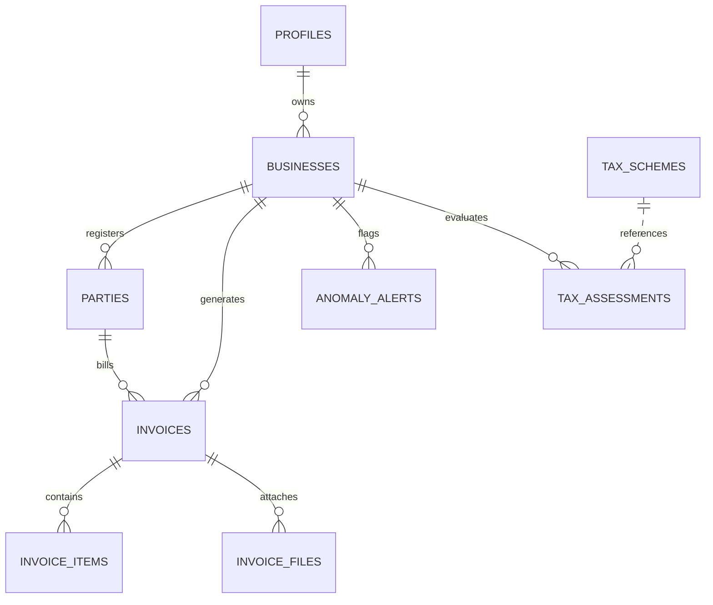

# Integrated Invoice Analytics and Tax Optimization Decision Support System

An enterprise-grade, full-stack financial analytics, GST compliance, invoice anomaly detection, and statutory tax optimization decision support platform engineered specifically for Indian startups and MSMEs.

---

## Key Capabilities & Modules

1. **Multi-Tenant Business Management**
   - Manage multiple business entities (Private Limited, LLP, Sole Proprietorship, Partnership).
   - Configure financial year, turnover brackets, GST registration status, and DPIIT Startup recognition.
   - Built-in demonstration entity: **DemoTech Solutions Private Limited** (Tamil Nadu IT startup).

2. **Customer & Supplier Directory (`/parties`)**
   - Single unified relational table managing both customers and vendors.
   - Dynamic place-of-supply state tracking and GSTIN validation.

3. **Compliant Invoice Engine (`/invoices`, `/invoices/new`, `/invoices/[id]`)**
   - Create and finalize sales (outward supplies) and purchase (inward supplies) invoices.
   - Line-item calculator with precision decimal arithmetic avoiding floating-point rounding bugs.
   - Automatic statutory tax classification:
     - **Intra-State Transactions:** Equal split into Central GST (CGST) and State GST (SGST).
     - **Inter-State Transactions:** Integrated GST (IGST).
   - Supports 0%, 5%, 12%, 18%, and 28% standard Indian GST slabs.
   - Real-time balance tracking, draft saving, and partial/full payment recording.
   - Printable tax invoice format with standard declarations and terms.

4. **Executive Financial Analytics & Dashboard (`/dashboard`, `/analytics`)**
   - Real-time KPIs: Total Sales, Total Purchases, Taxable Sales, Sales GST Output, Recorded Input Tax, Outstanding Receivables, Outstanding Payables, and Overdue balances.
   - Monthly revenue trajectories and expense trend charts powered by Recharts.
   - GST tax component breakdown donut charts.
   - Customer concentration analysis and vendor spend distribution.
   - Statutory notice clarifying that recorded purchase input tax is subject to statutory GSTR-2B ITC matching under Section 16 & 17(5).

5. **Tax Optimization Decision Support Engine (`/tax-optimization`)**
   - Transparent, versioned, deterministic rule evaluator comparing business financial parameters against Indian statutory provisions:
     - **Section 80-IAC:** 100% tax holiday for 3 consecutive assessment years for eligible DPIIT recognized startups with IMB approval.
     - **Section 44AD:** Presumptive taxation scheme for resident small businesses (6% digital / 8% cash turnover deemed profit).
     - **Section 44ADA:** Presumptive taxation for technical consultants and specified professionals (50% deemed profit).
     - **GST Composition Scheme (Section 10):** Simplified flat-rate scheme (1% to 6%) with quarterly CMP-08 filing.
     - **Udyam MSME Registration:** Priority sector lending and mandatory 45-day buyer payment compliance under Section 43B(h).
     - **CGTMSE:** Collateral-free credit facility guarantee up to ₹5 Crore.
     - **Pradhan Mantri MUDRA Yojana (PMMY):** Institutional loans up to ₹10-20 Lakhs.
     - **Startup India Seed Fund Scheme (SISFS):** Proof-of-concept grants up to ₹20L and debt up to ₹50L.
     - **Tamil Nadu TANSEED:** Seed grant up to ₹15 Lakhs for Tamil Nadu incorporated startups via StartupTN.
     - **DPIIT Recognition:** 80% patent rebate and regulatory self-certification.
   - Displays confidence scores, qualification rationale, missing prerequisites, and disqualifications.
   - Includes mandatory statutory non-filing disclaimer.

6. **Rule-Based Anomaly Detection Engine (`/anomalies`)**
   - Live audit scan identifying:
     - Duplicate invoice numbers.
     - Suspicious duplicate billing patterns (identical party, date, and amount).
     - Place of supply tax treatment mismatches (e.g. charging IGST on intra-state supplies).
     - Arithmetic calculation discrepancies between line items and totals.
     - Statistical value outliers exceeding 4.5x historical average.
     - Overdue receivables exceeding 45-day grace periods.
     - Non-standard GST rate applications.
   - Detailed structured JSON evidence modal for human auditor investigation, dismissal, or resolution.

7. **Reports & Data Export (`/reports`)**
   - One-click CSV downloads for:
     - Comprehensive Invoice Register
     - GSTR-1 / GSTR-3B Tax Preparation Schedules
     - Accounts Receivable Ageing Schedule
     - Accounts Payable Schedule
     - Anomaly Audit Report
   - Print-friendly Monthly Income & Expense Statements.

8. **Settings & Seed Synchronization (`/settings`)**
   - Live Supabase PostgreSQL and Auth status checker.
   - Idempotent sample data synchronization.
   - Storage bucket status (`invoice-documents`).
   - Pluggable OCR interface (`lib/ocr/provider.ts`).

---

## Technology Stack

- **Framework:** Next.js 16 (App Router, Turbopack, React 19, TypeScript)
- **Styling:** Tailwind CSS (Custom SaaS design system, navy typography, responsive design)
- **Charts:** Recharts
- **Icons:** Lucide React
- **Database:** Supabase PostgreSQL with Row Level Security (RLS)
- **Auth:** Supabase Auth (`@supabase/ssr` & `@supabase/supabase-js`)
- **Storage:** Supabase Storage (`invoice-documents` private bucket)
- **Testing:** Vitest (11 unit tests covering GST math, anomaly rules, and tax decision logic)
- **Hosting Target:** Vercel

---

## Getting Started Locally

### 1. Prerequisites
- **Node.js:** v18.0.0 or higher (v20+ / v22+ recommended)
- **npm:** v9.0.0 or higher

### 2. Dependency Installation
```bash
npm install --legacy-peer-deps
```

### 3. Environment Configuration
Create a `.env.local` file in the root directory (based on `.env.example`):
```env
NEXT_PUBLIC_SUPABASE_URL=https://vlpxhglwybbbgqysxryg.supabase.co
NEXT_PUBLIC_SUPABASE_PUBLISHABLE_KEY=your-supabase-publishable-or-anon-key
SUPABASE_SERVICE_ROLE_KEY=your-supabase-service-role-secret-key
```

### 4. Running Database Migrations in Supabase
To initialize your Supabase PostgreSQL database:
1. Open your [Supabase Dashboard](https://supabase.com/dashboard).
2. Navigate to **SQL Editor** in the left sidebar.
3. Open and run [`supabase/migrations/001_initial_schema.sql`](supabase/migrations/001_initial_schema.sql):
   - Creates `profiles`, `businesses`, `parties`, `invoices`, `invoice_items`, `tax_schemes`, `tax_assessments`, `anomaly_alerts`, and `invoice_files`.
   - Establishes relational foreign keys, cascade rules, check constraints, and performance indexes.
   - Enables Row Level Security (RLS) with user-isolation policies.
   - Creates the user profile trigger on `auth.users`.
4. Open and run [`supabase/migrations/002_storage_setup.sql`](supabase/migrations/002_storage_setup.sql):
   - Creates the private `invoice-documents` bucket with RLS policies.
5. Open and run [`supabase/seed.sql`](supabase/seed.sql):
   - Seeds the demo business (`DemoTech Solutions Private Limited`).
   - Seeds 10 customer and supplier records across Tamil Nadu and other states.
   - Seeds 10 statutory tax schemes with official government URLs.
   - Seeds 32+ sample invoices across FY 2024-25 with deliberate anomaly flags.
   - Seeds baseline tax assessments and audit alerts.

*(Note: The application also includes an in-memory sample dataset fallback, ensuring the entire UI, analytics, and audits function immediately even before running SQL).*

### 5. Start the Development Server
```bash
npm run dev
```
Open [http://localhost:3000](http://localhost:3000) in your browser.

---

## Running Tests & Production Build

### Run Unit Tests
```bash
npm test
```
Executes the Vitest test suite testing:
- GST place-of-supply intra vs inter-state tax splitting and arithmetic rounding (`tests/gst.test.ts`)
- Anomaly detection rules for duplicate invoices, tax mismatches, and outliers (`tests/anomalies.test.ts`)
- Statutory tax optimization criteria for Section 80-IAC, 44AD, 44ADA, and disclaimers (`tests/tax-rules.test.ts`)

### Run Production Build
```bash
npm run build
```
Generates the optimized Turbopack production bundle.

---

## Deployment to Vercel

### 1. Push to GitHub
```bash
git add .
git commit -m "feat: Integrated Invoice Analytics and Tax Optimization Decision Support System"
git branch -M main
git remote add origin https://github.com/<your-username>/<your-repo-name>.git
git push -u origin main
```

### 2. Import into Vercel
1. Log into [Vercel](https://vercel.com).
2. Click **Add New...** -> **Project**.
3. Select your GitHub repository.
4. Select **Next.js** as Framework Preset.
5. In the **Environment Variables** section, configure:
   - `NEXT_PUBLIC_SUPABASE_URL`: `https://vlpxhglwybbbgqysxryg.supabase.co`
   - `NEXT_PUBLIC_SUPABASE_PUBLISHABLE_KEY`: *(Your Supabase anon/publishable key)*
   - `SUPABASE_SERVICE_ROLE_KEY`: *(Your Supabase service_role secret key)*
6. Click **Deploy**.

### 3. Post-Deployment Verification
- Ensure user registration and login work via Supabase Auth.
- Verify invoice creation and analytics charts load from Supabase.
- Confirm CSV downloads generate in the production environment.

---

## Database Schema Architecture



---

## Security & Compliance Highlights

- **No Exposed Secrets:** Service role keys are restricted exclusively to server-side routes and scripts; never exposed to browser bundles.
- **Row Level Security:** Strict Supabase RLS policies guarantee users can only view and modify records belonging to their authenticated businesses.
- **Auditor Workflow:** Anomaly detection treats flags as indicators for human review rather than automatic determinations of fraud.
- **Legal Advisory:** Clear disclaimers stating that the system provides preliminary decision support and does not file tax returns.

---

## License
MIT License. Built for Indian Startup and MSME financial optimization.
